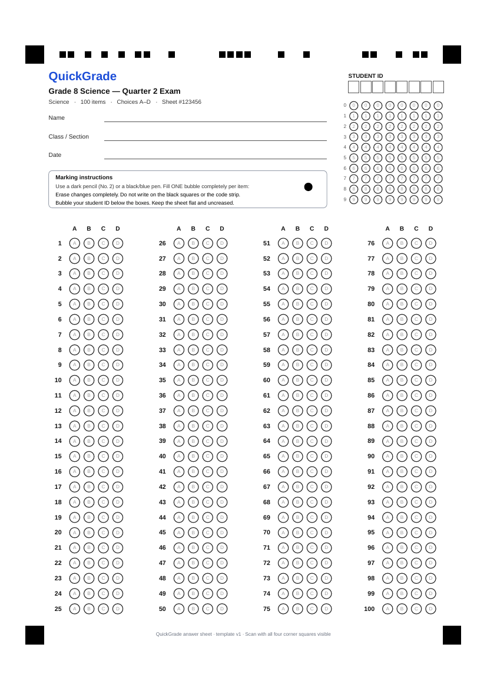

# Answer sheets, printing and scanning

## The QuickGrade sheet

Every sheet is generated from the quiz, so its layout always matches the quiz's number of items and choices.

| Element | Purpose |
|---|---|
| **Four black corner squares** (8 mm) | Registration markers: the scanner finds them, then corrects rotation and perspective |
| **Code strip** (row of small squares between the top markers) | 44-bit sheet code: template version, item count, choice count, the quiz's unique 20-bit sheet number, CRC-8. It identifies the quiz and the orientation |
| **Name / Class / Date lines** | For people only; not read by the scanner |
| **Student ID grid** (8 columns × digits 0–9) | The student bubbles their student number, left-aligned; empty columns at the end are fine. Personalised sheets come pre-filled |
| **Answer bubbles** | 1–100 items, 2–5 choices, laid out in up to 4 columns; letters printed lightly inside |

The frame (marker centre to marker centre) is 180 × 250 mm and is centred on the page, so the same template prints correctly on **A4** and **US Letter / short bond**.

## Printing

1. Open the quiz → **Print sheets**. Choose the paper size and either *blank copies* or *one personalised sheet per student* (the class roster's name and pre-bubbled ID).
2. In the print dialog choose **100% / Actual size**. Do **not** use "Fit to page" or "Shrink to fit".
3. Print in black on plain white paper. Photocopies work if they are 1:1 and not too light.
4. If you change a quiz's number of items or choices, the quiz gets a new sheet code and old printed sheets are rejected ("does not belong to this quiz"). Reprint them.

## Instructing students

- Use a dark pencil (No. 2) or a black/blue pen, and **fill one bubble completely** per item.
- Erase changes completely. Partly erased marks are flagged for the teacher.
- Bubble the student ID under the boxes.
- Do not write on the black squares or the code strip, and do not fold the sheet across them.

## Photographing sheets

- Lay the sheet flat on a plain, preferably darker, surface, under even light (no phone shadow).
- Fit the whole sheet in the frame: **all four corner squares and the code strip must be visible**. Fill most of the frame.
- Hold the phone roughly parallel to the paper. Rotation in any direction (even upside down) and moderate tilt are corrected automatically.
- Tap to focus. Blurry photos are rejected rather than guessed.

You can upload many photos at once (**Upload photos** accepts multiple files). Each one is scanned and queued for review.

## What the scanner reports

For every item: `ok` (one clear mark), `blank`, `multiple` (two or more marks of similar darkness) or `ambiguous`. Ambiguous covers a faint or partial mark, a mark next to a heavy smudge (possible erasure), and a mark much lighter than the student's other marks, such as a tick. It also gives a fill level per bubble and a confidence value. **Confidence describes how sure the scanner is about what is on the paper, not whether the answer is correct.**

The review screen lists the flagged items with a photo crop of each row. You confirm or correct each one ("Keep as shown" or tap a bubble), confirm the student, and only then save. The server re-checks that every flagged item was reviewed.

### Errors and what to do

| Message | Typical cause | Fix |
|---|---|---|
| Could not find the four black corner squares | Sheet cropped, too far away, marker covered or folded | Retake with all corners visible, closer |
| The sheet code strip could not be read | Strip covered, written on, glare | Retake; if the strip is damaged, select the quiz's session first: QuickGrade then uses the selected layout and asks you to confirm |
| This answer sheet belongs to quiz "X" | Sheet scanned in the wrong session | Scan it in a session for quiz X |
| …does not belong to this quiz | Printed before the quiz layout changed | Reprint sheets |
| Photo too blurry / too dark / overexposed / resolution too low | Camera conditions | Steady hands, more light, avoid flash glare, full resolution |
| This photo was already graded / is waiting for review | Same file uploaded twice | Open the existing scan |

## Testing camera scanning

Browsers allow `getUserMedia` (live camera) only in a **secure context**: `https://…` or `http://localhost`.

- **On a laptop with a webcam:** `npm run dev`, open <http://localhost:5173/scan>, choose a session, then **Use camera**.
- **On a phone (same Wi-Fi):** the phone cannot use `localhost`, so serve over HTTPS. Two easy options:
  - `npm run build && HOST=0.0.0.0 node dist/server/index.mjs`, then `cloudflared tunnel --url http://localhost:3000` (or `ngrok http 3000`) and open the printed `https://` URL on the phone. Set `TRUST_PROXY=true`.
  - Deploy behind Caddy/nginx with a certificate (see deployment.md).
- **Without HTTPS:** use **Upload photos**. On Android and iOS the picker offers "Camera", so you can still take the photo with the native camera app.
- **Without a printer:** `npm run sample-sheets -- <sheetCode> <items> <choices> <studentNumber>` writes realistic simulated photos to `samples/` (requires `pdftoppm`). `samples/answers.txt` lists the marked answers so you can check the result.

## Known limitations

- Only QuickGrade sheets are supported; one correct answer per item; ≤ 100 items, ≤ 5 choices, ≤ 8-digit student IDs.
- Accuracy is verified on simulated photos rendered from the real PDF. Field tests with physical sheets are still to be done, and thresholds may need tuning for very light pencil or unusual printers.
- A missing or heavily folded corner marker cannot be recovered; strong fisheye distortion is not modelled.
- `.heic` files may not decode; JPEG/PNG/WebP are supported.
